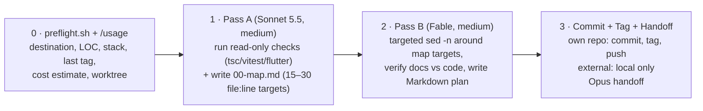

# `/fable-review` — two-pass independent codebase audit (Fable analyzes, Opus executes)

> **TL;DR** One model (Opus) writes the implementation; a second, heavier model
> (Fable) reviews a frozen commit read-only and writes structured Markdown
> findings and phased refactor plans into the repository for Opus to execute next.
> Mined from 28 Fable review sessions (June – October 2026) and hardened after a
> run of five Fable subagents (three in parallel) burned 7% of a weekly Max 5x quota ($30.46 API-equivalent) in
> 14 minutes by reading whole repositories into 636k-token contexts.

- [`SKILL.md`](SKILL.md) — the skill, English, generic. Install this one.
- [`SKILL.hr.md`](SKILL.hr.md) — the same skill written in Croatian, for reading.
- [`templates/`](templates/) — what the subagents read: `pass-a.md`, `pass-b.md`, and one output structure per mode.
  A subagent sees only its prompt, never the parent's SKILL.md, so these are passed to it by absolute path.
- [`scripts/salvage.py`](scripts/salvage.py) — runs after every Fable agent and writes all recoverable output (final report, text, full Write/Edit contents, usage per call, cost in USD) to one local Markdown file, even when the agent crashed or hit a rate limit. It marks a run that did not finish, so the last remark of a stopped agent is not mistaken for its report. Thinking is stored empty by Claude Code and cannot be recovered; its token count is reported.
- [`scripts/preflight.sh`](scripts/preflight.sh) — deterministic, read-only pre-flight: review base, owner and
  visibility, **destination** (`COMMIT` / `LOCAL-ONLY` / `ASK`), lines of code, stack and ground-check candidates,
  previous `audit-*` tags and local reports, `Co-Authored-By` statistics, and a cost estimate.

Blog post with the telemetry and chronology:
**[stepanic.domovina.ai/blog/fable-review-skill-two-model-code-audits](https://stepanic.domovina.ai/blog/fable-review-skill-two-model-code-audits)**

## Two-pass architecture



Why two passes instead of handing the repository directly to Fable:
- Fable 5.1 is **2.5× the price of Opus 5.5** ($10/$50 vs $4/$20 per MTok; 5-minute cache write $12.50/MTok) and **5× the price of Sonnet 5.5** ($2/$10 per MTok).
- In the 2026-10-16 incident ([postmortem](../../docs/2026-10-17-postmortem-fable-subagenti-tjedni-limit.md)), a single-pass Fable agent on [`domovinatv/pay.domovina.ai`](https://github.com/domovinatv/pay.domovina.ai) (59k lines of code at the time) ran `cat -n` over whole files, grew its context to **636k tokens across 44 turns**, sent **11.6M input tokens**, and cost **$13.96** (55% cache writes).
- Running Pass A on Sonnet 5.5 (~$1.50–3.00) to produce a 200-line map of entry points, invariants, and `file:line` hotspots lets Pass B on Fable 5.1 read 150-line slices with `sed -n`, keeping context under **150k tokens** with an *estimated* Fable cost of ~$3–6 per repository. The estimate comes from Fable 5.1 prices and the incident transcripts. The first measured run (2026-11-16, a `diff` review of this skill on Fable 5.2 at effort low) took 7 calls, a 102k peak context and $2.51.

## Five modes

| Mode | Scope | Question answered | Output in repo | Estimated cost (Pass A + B) |
|---|---|---|---|---|
| **`diff`** *(weekly / PR)* | Commits since the last `audit-*` tag, or since `--base <ref>` | *"Can this week's Opus changes ship safely, and were prior Fable findings actually fixed?"* | `docs/reviews/<date>-fable-diff-<topic>.md` | **$2–5** (measured: $2.51 for ~1,150 changed lines, effort low) |
| **`refactor`** | Module boundaries, largest files, duplication, test/CI gaps | *"How should Opus split and clean up this codebase in green waves without breaking invariants?"* | `docs/refactor/<date>-code-review-and-refactor-plan.md` | **$4–7** |
| **`security`** | Entry points, auth, money/ledger flows, secrets, DB queries | *"Where can an attacker steal funds/data, bypass auth, or trigger a race condition?"* | `docs/security/<date>-security-audit-fable.md` | **$4–7** |
| **`full`** | Whole repo split into 2–4 subsystems (`security` + `refactor`) | *"Give me a subsystem-by-subsystem audit, coverage matrix, and master P0–P2 plan for Opus."* | `docs/reviews/<date>-fable/{INDEX,<subsystems>,implementation-plan}.md` | **$8–15** |
| **`forensic`** | `git log` + `Co-Authored-By` trailers + shared-file diffs | *"Which model wrote what, who introduced vs fixed which bugs, scored 0–100 with commit hashes?"* | `docs/research/<date>-model-forensics.md` | **$3–5** |

## Rules that matter

- **Zero code modifications during review.** The reviewer never edits source files, tests, or configs. Mixing review and edits in one pass hides what changed and why.
- **"Confirmed GOOD — DO NOT TOUCH" is mandatory.** In [`domovinatv/pay.domovina.ai`](https://github.com/domovinatv/pay.domovina.ai), [`domovinatv/domovina-fiskal`](https://github.com/domovinatv/domovina-fiskal), and [`domovinatv/energy.domovina.ai`](https://github.com/domovinatv/energy.domovina.ai), the most valuable section for the subsequent Opus pass was the explicit list of empirical invariants (10-line EPC QR layout for Revolut iOS, 14-field FINA HUB3 format, ZKI/XML-DSIG signing, atomic SQL latches) that a refactor must not "simplify".
- **Every finding requires a concrete failure scenario and verification check.** Plausible concerns that cannot be proven from repo code alone go into a separate *"Unverified / For human check"* section rather than inflating the finding count.
- **Annotated git tag `audit-fable-YYYY-MM-DD-<mode>[-N]`.** Every completed review of an own repository tags the reviewed state, giving the next `diff` run an exact baseline range. Preflight picks the next free name, so two reviews on one day do not collide.
- **Only your own repositories get commits.** Preflight parses host and owner from the origin URL and compares `host/owner` literally with an allow-list in `~/.config/fable-review/own-owners` (one entry per line, or `FABLE_REVIEW_OWN_OWNERS`). A bare entry such as `stepanic` means `github.com/stepanic`; other hosts need the full form, such as `gitlab.com/stepanic`. Anything else is `LOCAL-ONLY`: the review is written to `~/.claude/fable-review/reports/<owner>-<repo>/` and nothing is committed, tagged or pushed to that repository or copied anywhere else. A repo without remote, an unparsable URL, or a missing list yields `ASK`.
- **Only review documents reach the default branch.** Before the push, the skill checks that the review branch differs from `origin/<default>` only in files under the output directory. A `diff` review based on an unpushed feature branch fails that check, so only the review branch is pushed and the feature commits never ship by accident.
- **Push only after rebase, clean up only after push.** The worktree lives under `~/.claude/fable-review/worktrees/` on a named branch, so a rejected push or a reboot cannot strand the review.

## Public examples

- [`domovinatv/pay.domovina.ai`](https://github.com/domovinatv/pay.domovina.ai) — [`docs/reviews/2026-07-fable5/`](https://github.com/domovinatv/pay.domovina.ai/tree/main/docs/reviews/2026-07-fable5) (46 findings + F0–F3 plan), [`docs/reviews/2026-10-fable51/`](https://github.com/domovinatv/pay.domovina.ai/tree/main/docs/reviews/2026-10-fable51) (35 findings), [`docs/reviews/2026-10-fable51-r2/`](https://github.com/domovinatv/pay.domovina.ai/tree/main/docs/reviews/2026-10-fable51-r2) (32 delta findings), [`docs/security/2026-10-16-security-audit-fable.md`](https://github.com/domovinatv/pay.domovina.ai/blob/main/docs/security/2026-10-16-security-audit-fable.md), and [`docs/research/fable5-vs-opus48-side-by-side.md`](https://github.com/domovinatv/pay.domovina.ai/blob/main/docs/research/fable5-vs-opus48-side-by-side.md) + [`opus48-independent-forensic-fable5-vs-opus48.md`](https://github.com/domovinatv/pay.domovina.ai/blob/main/docs/research/opus48-independent-forensic-fable5-vs-opus48.md).
- [`stepanic/stadion-maksimir-natjecaj-2026`](https://github.com/stepanic/stadion-maksimir-natjecaj-2026) — [`docs/review/README.md`](https://github.com/stepanic/stadion-maksimir-natjecaj-2026/blob/main/docs/review/README.md) and four tagged Fable 5.1 reviews (`F-01`…`F-37`, `E-01`…`E-15`).
- [`domovinatv/energy.domovina.ai`](https://github.com/domovinatv/energy.domovina.ai) — [`docs/refactor/00-pregled.md`](https://github.com/domovinatv/energy.domovina.ai/blob/main/docs/refactor/00-pregled.md) (30 refactor items in 6 waves).
- [`domovinatv/domovina-fiskal`](https://github.com/domovinatv/domovina-fiskal) — [`docs/handoff/2026-10-02-pregled-koda-i-plan-refactora.md`](https://github.com/domovinatv/domovina-fiskal/blob/main/docs/handoff/2026-10-02-pregled-koda-i-plan-refactora.md) (model attribution + 24 findings `K1`–`K24` + 9-step refactor plan).
- [`domovinatv/pipeline.domovina.ai`](https://github.com/domovinatv/pipeline.domovina.ai) & [`domovinatv/omm.domovina.ai`](https://github.com/domovinatv/omm.domovina.ai) — `docs/security/2026-10-16-security-audit-fable.md`.

## Install

```bash
git clone --depth 1 --filter=blob:none --sparse https://github.com/stepanic/cv ~/src/stepanic-cv
git -C ~/src/stepanic-cv sparse-checkout set skills/fable-review
ln -s ~/src/stepanic-cv/skills/fable-review ~/.claude/skills/fable-review   # or cp -R
mkdir -p ~/.config/fable-review && echo "<your-github-login>" > ~/.config/fable-review/own-owners
```

Requires Claude Code (the skill uses `${CLAUDE_SKILL_DIR}`, `$ARGUMENTS` and the Agent tool's `model` and `effort`
parameters). Other agents that read the same `SKILL.md` format can run `preflight.sh` and Pass A, but cannot spawn a
Fable subagent.

Then type `/fable-review`, `/fable-review <repo> --mode diff` or `/fable-review <repo> --mode refactor`. The skill sets
`disable-model-invocation: true`: Claude never starts it, or a Fable agent, on its own. Fable quota is spent only when you type the command.

MIT.
