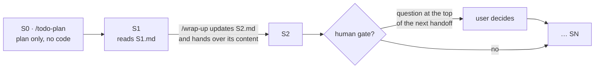

# `/todo-plan` — an implementation planned as a chain of sessions

> **TL;DR** A larger implementation does not fit in one Claude Code context. This
> skill writes the plan into the repo as N packages, one per session, each with a
> "done when" that a command can check, and one handoff file per session that is
> already the prompt for the next empty context. The planning session (S0) writes no
> code.

- [`SKILL.md`](SKILL.md) — the skill, English, generic. This is the one to install.
- [`SKILL.hr.md`](SKILL.hr.md) — the Croatian original as it runs on my machine.

It works together with [`/wrap-up`](../wrap-up/): when a session finishes package
`SN`, wrap-up does not write a fresh handoff but updates `S(N+1).md` and hands over
its content.

## What it produces

| File | Content |
|---|---|
| `TODO.md` | Items grouped by phase (F0, F1…), each concrete and tagged with its session (`→ S3`) |
| `docs/plan.md` | Why the project exists, hard constraints, the session table `# · Phase · Package · Decisions · Done when`, gates, risks |
| `docs/decisions.md` | Numbered decisions; each session gets its own block (S1 from 100, S2 from 200…) |
| `docs/handoffs/README.md` | The chain rules, a "Chain status" table, shared rules for every session |
| `docs/handoffs/S1.md` … `SN.md` | One ready-made prompt per session |



## Rules that matter

- **"Done when" is a command**: a green check, a test count, `skipped 0`, a measured
  number. Never "implemented".
- **Measure the risky assumption first.** Phase F0 builds the foundation and measures
  what everything else depends on; if the result can kill the project, a gate
  follows it.
- **Gates are written down.** A package ending in an irreversible or external action
  stops the chain with the question at the top of the next handoff, so a later
  session cannot skip it.
- **No numbers without measurement.** An unknown estimate becomes a measurement
  inside a package.

## Examples

Public repos planned this way:
[`pinkainc/open-banking`](https://github.com/pinkainc/open-banking),
[`pinkainc/open-ledger`](https://github.com/pinkainc/open-ledger) and
[`domovinatv/domovina.ai/vijesti`](https://github.com/domovinatv/domovina.ai/tree/main/vijesti).

## Install

```bash
mkdir -p ~/.claude/skills/todo-plan
curl -sSL https://raw.githubusercontent.com/stepanic/cv/main/skills/todo-plan/SKILL.md \
  -o ~/.claude/skills/todo-plan/SKILL.md
```

Then say "make a TODO plan" or "plan this so it gets implemented in N sessions", or
invoke `/todo-plan`.

MIT.
